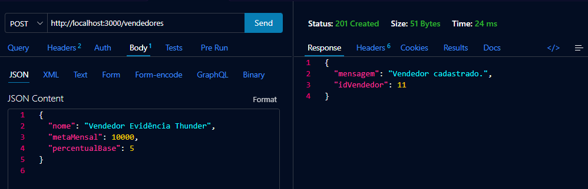
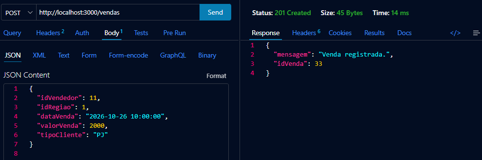
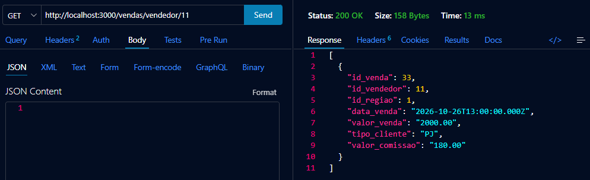

# Evidências no Thunder Client

As imagens desta pasta registram três requisições executadas na API usando o Thunder Client. Elas demonstram o cadastro de vendedor, o registro de uma venda e a comissão calculada e persistida.

## 1. Cadastro de vendedor — `criar_vendedor.png`

- Requisição: `POST http://localhost:3000/vendedores`
- Dados enviados: vendedor com meta mensal de R$ 10.000,00 e percentual base de 5%.
- Resultado: HTTP `201 Created`; a API cadastrou o vendedor e retornou o `idVendedor` `11`.

## 2. Registro de venda — `registrar_venda.png`

- Requisição: `POST http://localhost:3000/vendas`
- Dados enviados: vendedor `11`, região `1` (Norte), cliente PJ e venda de R$ 2.000,00.
- Resultado: HTTP `201 Created`; a API registrou a venda com o ID `33`.

## 3. Consulta e conferência da comissão — `conferir_comissao.png`

- Requisição: `GET http://localhost:3000/vendas/vendedor/11`
- Resultado: HTTP `200 OK`; a resposta mostra a venda registrada e `valor_comissao` de `180.00`.
- Conferência: 5% de comissão base + 3% de bônus PJ + 1% de bônus Norte = 9%; 9% de R$ 2.000,00 = R$ 180,00.

As três capturas mostram a sequência completa: cadastro, venda vinculada ao vendedor e leitura do valor de comissão gravado no banco.
